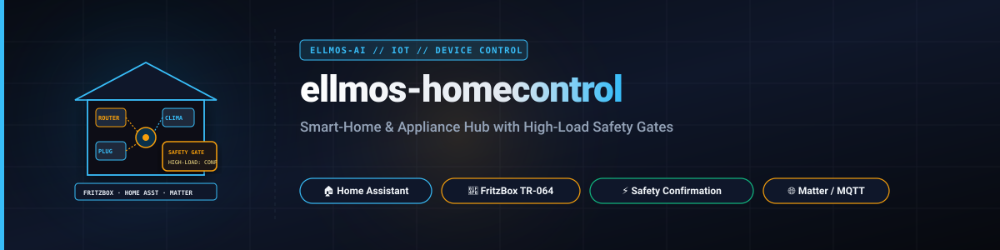

<p align="center">
  
</p>

# ellmos-homecontrol

**English** | [Deutsch](README_de.md)

Smart-home, household appliance, and vendor-neutral router control hub for the ellmos ecosystem (BACH, Open Ocean). It defines a device model, four smart-home adapter classes, a vendor-neutral `RouterAdapter` layer (`FritzBoxRouterAdapter`, `HuaweiHiLinkRouterAdapter`, `GenericGatewayAdapter`), and a tool-shaped hub API (`hc_*`) with confirmation and authority gates. A small, dependency-free Python package.

> **Status: early (v0.1.0).** `FritzBoxAdapter` / `FritzBoxRouterAdapter` (TR-064 SOAP with HTTP Digest auth and mandatory post-switch `GetInfo` readback) and `HuaweiHiLinkRouterAdapter` (read-only `/api/device/basic_information` & `/api/monitoring/status`) implement real local protocol handlers. The Home Assistant, Matter and MQTT/Shelly adapters currently hold connection settings. `HomeControlHub` works on an **in-memory device registry**: unless you pass your own devices it uses four built-in sample devices, and every device result is marked `"demo": true`.

## What it does

- **`HomeControlHub`** exposes the tool surface:
  - `hc_list_devices(adapter=None)`, `hc_get_state(device_id)`
  - `hc_set_state(device_id, target_state, confirmed=False)`
  - `hc_scene_activate(scene_id)` (built-in scenes `focus_work` and `evening_calm`)
  - `hc_energy_status()` (summed power, per adapter)
  - `hc_router_discover(gateway_ip="192.0.2.1")`, `hc_router_status()`, `hc_router_hosts()`, `hc_router_wifi_status()` (`network-observer` role, Tier 1)
  - `hc_router_set_guest_wifi(enabled, confirmed=..., evidence_quote=...)` (Tier 2) and `hc_router_set_wifi(enabled, confirmed=..., hard_gate_ack=...)` (Tier 3 hard gate when disabling main Wi-Fi)
- **Permission gate:** with `smarthome_permission=False` every call raises `PermissionError`.
- **Confirmation gate:** `hc_set_state` raises `HighLoadConfirmationRequiredError` unless `confirmed=True` when the device
  - has `requires_confirmation`, or
  - is of kind `oven`, `stove`, `lock`, `garage_door` or `heater_high_load`, or
  - is rated above 2000 W and is not a plain `plug`.
- **Vendor-neutral `RouterAdapter` & `discover_router()`:**
  - Probes TCP `:49000` first before attempting AVM TR-064 (`FritzBoxRouterAdapter`), detects Huawei HiLink LTE/5G gateways via `/api/device/basic_information` (`HuaweiHiLinkRouterAdapter`), and falls back safely to `GenericGatewayAdapter`.
  - Enforces mandatory `GetInfo` readback after every `SetEnable` Wi-Fi switch (`verified: true/false`), resolves credentials via OS `keyring` -> `ELLMOS_HOMECONTROL_CREDENTIALS_DIR`, and masks passwords as well as `SesInfo`/`TokInfo` session tokens in all errors.
  - Raises `UnsupportedCapabilityError` for unsupported vendor actions instead of silent false positives.

## Installation

Requires Python 3.10 or newer; there are no runtime dependencies. From a clone:

```bash
pip install -e .
pip install -e ".[dev]"   # pytest
```

## Usage

```bash
ellmos-homecontrol list --adapter fritzbox
ellmos-homecontrol get ha.light.studio_main
ellmos-homecontrol set ha.light.studio_main '{"brightness_pct": 50}'
ellmos-homecontrol set shelly.appliance.washer '{"on": true}' --confirm
ellmos-homecontrol scene evening_calm
ellmos-homecontrol energy
ellmos-homecontrol router-discover --gateway 192.0.2.1
ellmos-homecontrol router-status --gateway 192.0.2.1
ellmos-homecontrol router-set-guest-wifi on --gateway 192.0.2.1 --confirm
```

```python
from ellmos_homecontrol.hub import HomeControlHub, HomeDevice

hub = HomeControlHub(devices=[
    HomeDevice("plug.desk", "Desk plug", "fritzbox", "plug", {"on": True}, power_watts=40, max_rated_watts=2300),
])
print(hub.hc_energy_status()["total_power_watts"])   # 40.0, demo is False for custom devices
```

Tests live in `tests/test_homecontrol.py` and `tests/test_router_adapter.py` (run with `pytest`).

## Relation to ellmos and Open Ocean

`ellmos-homecontrol` is one of the extension modules listed in the [Open Ocean](https://github.com/ellmos-ai/open-ocean) module map. Its FritzBox code was extracted from the smart-home handler of [BACH](https://github.com/ellmos-ai/bach). Module metadata and `network-observer` / `router-operator` roles are in `ellmos-module.v2.json`.

## License

MIT, as declared in `pyproject.toml`.
