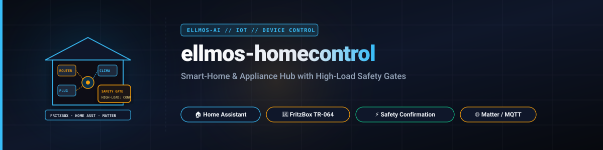

<p align="center">
  
</p>

# ellmos-homecontrol

[English](README.md) | **Deutsch**

Steuerzentrale für Smart Home und Haushaltsgeräte im ellmos-Ökosystem (BACH, Open Ocean). Das Paket definiert ein Gerätemodell, vier Adapterklassen und eine werkzeugförmige Hub-API (`hc_*`) mit Bestätigungs-Gate für Hochlast- und sicherheitskritische Geräte. Ein kleines, abhängigkeitsfreies Python-Paket.

> **Status: early (v0.1.0), Demo-Stand.** Nur der FritzBox-Adapter enthält echten Protokollcode (ein TR-064-SOAP-Helfer). Die Adapter für Home Assistant, Matter und MQTT/Shelly halten bisher nur Verbindungseinstellungen. `HomeControlHub` arbeitet auf einer **Geräteregistry im Arbeitsspeicher**: Ohne eigene Geräte werden vier eingebaute Beispielgeräte verwendet, und jedes Ergebnis trägt `"demo": true`. `hc_set_state` ändert diesen Speicherzustand; Befehle an echte Geräte werden noch nicht gesendet.

## Funktionen

- **`HomeControlHub`** bietet die Werkzeugoberfläche:
  - `hc_list_devices(adapter=None)`, `hc_get_state(device_id)`
  - `hc_set_state(device_id, target_state, confirmed=False)`
  - `hc_scene_activate(scene_id)` (eingebaute Szenen `focus_work` und `evening_calm`)
  - `hc_energy_status()` (Gesamtleistung, je Adapter)
- **Berechtigungs-Gate:** Mit `smarthome_permission=False` löst jeder Aufruf `PermissionError` aus.
- **Bestätigungs-Gate:** `hc_set_state` löst `HighLoadConfirmationRequiredError` aus, solange nicht `confirmed=True` gesetzt ist, wenn das Gerät
  - `requires_confirmation` hat, oder
  - vom Typ `oven`, `stove`, `lock`, `garage_door` oder `heater_high_load` ist, oder
  - über 2000 W ausgelegt und kein einfacher `plug` ist.
- **`HomeDevice`**: eingefrorene Dataclass (`device_id`, `name`, `adapter`, `kind`, `state`, `power_watts`, `max_rated_watts`, `requires_confirmation`).
- **Adapter** (`fritzbox`, `homeassistant`, `matter`, `mqtt_shelly`):
  - `FritzBoxAdapter.tr064_call(service, action, params)` baut und sendet eine TR-064-SOAP-Anfrage (2,5 s Zeitlimit, Standard-Basis-URL `http://fritz.box:49000`). Aktions- und Parameternamen werden geprüft, alle Werte XML-escaped; ungültige Namen liefern `None`. `xml_value(xml, tag)` liest einen Wert aus einer Antwort.
  - `HomeAssistantAdapter`, `MatterBridgeAdapter`, `MqttShellyAdapter`: reine Konfigurationshalter (Basis-URL, Fabric-Name, Broker-Host und -Port) ohne Netzwerkcode.

## Installation

Benötigt Python 3.10 oder neuer; es gibt keine Laufzeitabhängigkeiten. Aus einem Klon:

```bash
pip install -e .
pip install -e ".[dev]"   # pytest
```

## Nutzung

```bash
ellmos-homecontrol list --adapter fritzbox
ellmos-homecontrol get ha.light.studio_main
ellmos-homecontrol set ha.light.studio_main '{"brightness_pct": 50}'
ellmos-homecontrol set shelly.appliance.washer '{"on": true}' --confirm
ellmos-homecontrol scene evening_calm
ellmos-homecontrol energy
```

```python
from ellmos_homecontrol.hub import HomeControlHub, HomeDevice

hub = HomeControlHub(devices=[
    HomeDevice("plug.desk", "Schreibtisch-Steckdose", "fritzbox", "plug", {"on": True}, power_watts=40, max_rated_watts=2300),
])
print(hub.hc_energy_status()["total_power_watts"])   # 40.0, demo ist bei eigenen Geräten False
```

Die Tests liegen in `tests/test_homecontrol.py` (Aufruf mit `pytest`).

## Bezug zu ellmos und Open Ocean

`ellmos-homecontrol` gehört zu den Erweiterungsmodulen in der Modulzuordnung von [Open Ocean](https://github.com/ellmos-ai/open-ocean). Der FritzBox-Code wurde aus dem Smart-Home-Handler von [BACH](https://github.com/ellmos-ai/bach) extrahiert. Die Modul-Metadaten stehen in `ellmos-module.v2.json`.

## Lizenz

MIT, wie in `pyproject.toml` angegeben.
